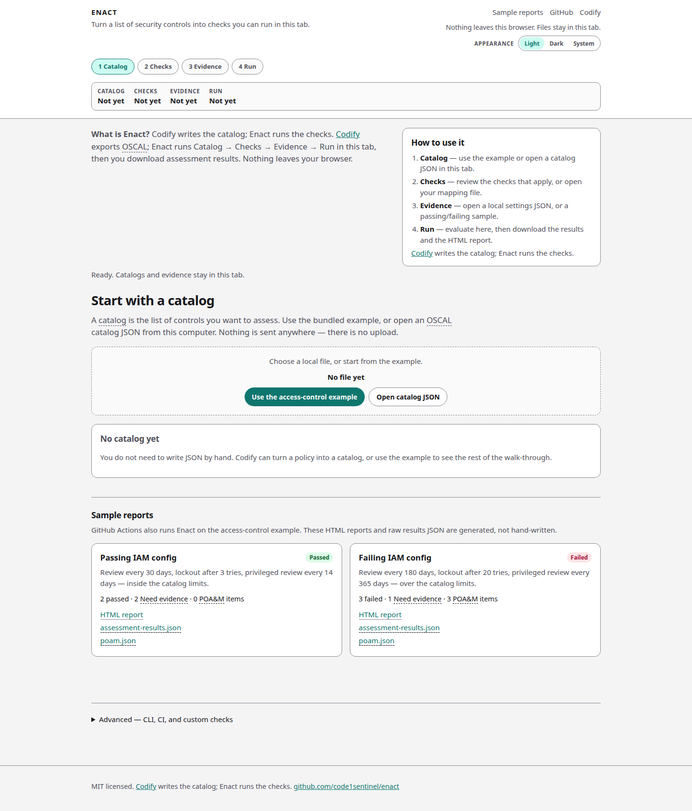

# Enact

Enact turns a list of security controls into checks you can run, then writes the results back as official OSCAL files.

[Codify](https://code1sentinel.github.io/policy-golden-path/) writes the catalog. Enact runs the checks. You work in four steps: **Catalog → Checks → Evidence → Run**. Nothing leaves the tab.

**Open Enact:** [https://code1sentinel.github.io/enact/](https://code1sentinel.github.io/enact/)

## Who it is for

- **GRC reviewers** who have an OSCAL catalog and a settings file, and need assessment results without installing anything.
- **Engineers** who later want the same run in CI, or who write custom Rego checks.

You do not need Python, OPA, or a terminal for the starter library. That is the default path.

## What you get

After a run you can download:

- `assessment-results.json` — NIST OSCAL 1.1.2 results other GRC tools can read
- `poam.json` — Plan of Action and Milestones items for automated failures
- An HTML report you can open offline

Manual and hybrid checks that still need a person are labeled **Need evidence**. That is not a failure.


Enact is local-first. The hosted app evaluates in your browser. Catalogs and evidence are opened with the file picker; they are never uploaded. See [Privacy and security](privacy.md).


## What this book covers

| If you want to… | Start here |
| --- | --- |
| Try the bundled example | [Quick start](quick-start.md) |
| Walk each step | [Catalog](catalog.md), [Checks](checks.md), [Evidence](evidence.md), [Run and results](run-and-results.md) |
| Understand the files you download | [Outputs](outputs.md) |
| Learn the terms | [Concepts and glossary](concepts.md) |
| Write your own Rego | [Writing custom checks](custom-checks.md) and [CLI reference](cli.md) |
| Pair Enact with Codify | [Using Enact with Codify](codify.md) |
| Contribute | [Contributing](contributing.md) |

The Python CLI (`enact run`, `enact ui`) is optional. Custom and draft checks stay on that path — there is no in-browser Rego compiler.
