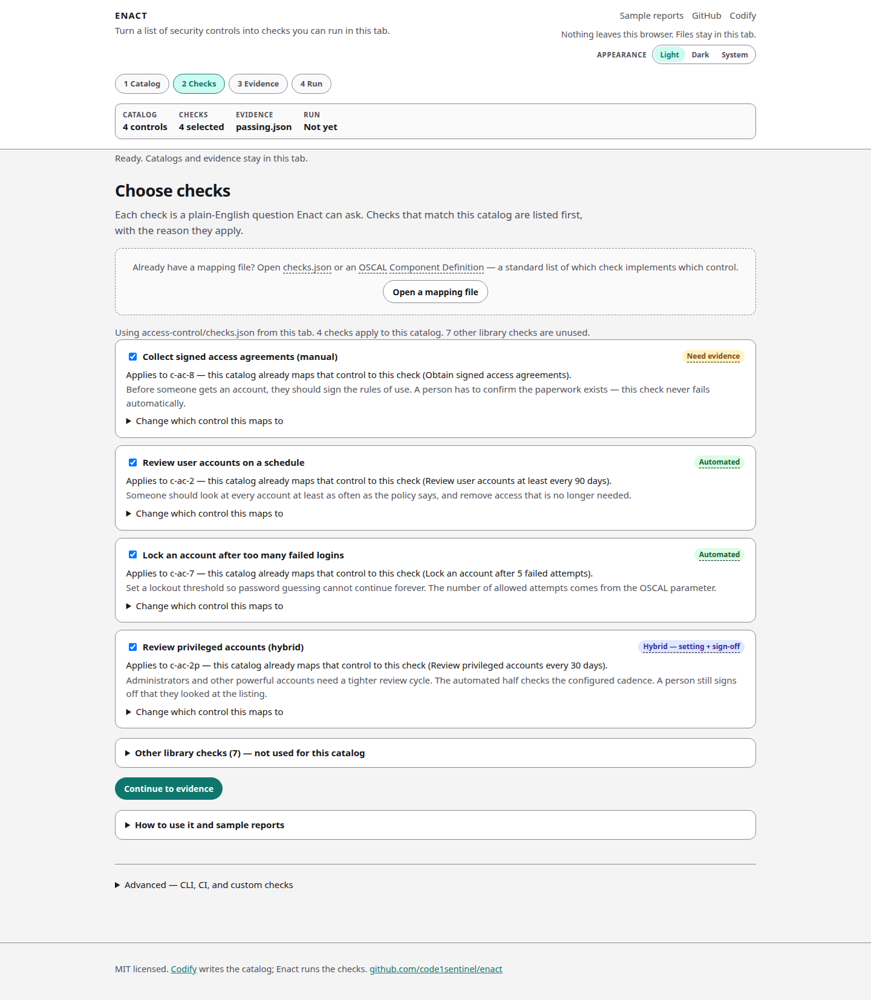

# Checks

A check is a plain-English question Enact can ask of a control. This step shows which library checks apply to the loaded catalog, and lets you open a mapping file you already have.

## Applicable vs other library checks

After the access-control example loads, checks that match the catalog sit at the top, each with a reason. Unused starter checks are collapsed under **Other library checks**.

The example selects four checks:

| Check | Type | Maps to | Why it applies |
| --- | --- | --- | --- |
| Collect signed access agreements | Manual | `c-ac-8` | Catalog already maps that control to this check. |
| Review user accounts on a schedule | Automated | `c-ac-2` | Catalog already maps that control to this check. |
| Lock an account after too many failed logins | Automated | `c-ac-7` | Catalog already maps that control to this check. |
| Review privileged accounts | Hybrid | `c-ac-2p` | Catalog already maps that control to this check. |

The rest of the starter library (MFA, password length, inactive accounts, logging, encryption, and similar) stays unused unless you map one by hand.

## Opening a mapping file

If you already have a mapping, click **Open a mapping file** and pick either:

- **`checks.json`** — Enact’s authoring file: which check covers which control.
- An **OSCAL Component Definition** — the same job in the standard OSCAL shape (C2P `Rule_Id` / `Check_Id` conventions).

Both are accepted. `checks.json` is what `enact init` and the library picker write. A Component Definition is the interchange format for tools in the OSCAL Compass family. See [Concepts](concepts.md).

## Check types

| Type | What Enact does |
| --- | --- |
| Automated | Runs the bundled policy against your evidence. Pass or fail. |
| Manual | Never fails on its own. Result is **Need evidence** until a person confirms the paperwork. |
| Hybrid | The automated half can fail. A pass still needs reviewer sign-off, so it is **Need evidence**, not Passed. |

Draft stubs (generated from unmatched controls) never count as passed. On localhost, `enact ui` can generate them; promotion is `enact checks review`. See [Writing custom checks](custom-checks.md).

## Custom checks

The hosted app runs the precompiled starter library. There is no in-browser Rego compiler. Custom or draft checks use the [CLI](cli.md).
