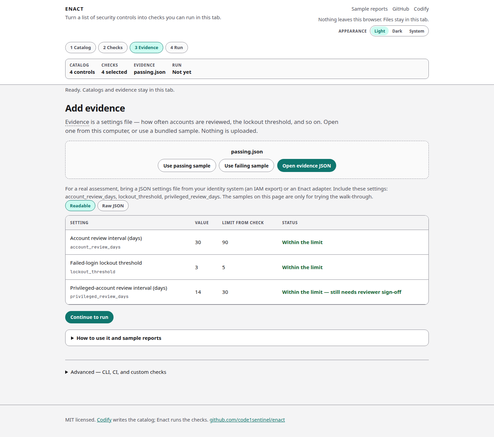

# Evidence

Evidence is a settings file — how the system is configured right now. Enact compares those values to the limits on the catalog.



## Readable table vs raw JSON

The **Readable** view is a table:

| Column | Meaning |
| --- | --- |
| Setting | The configuration Enact is looking at (`account_review_days`, `lockout_threshold`, …) |
| Value | What is in the file you opened |
| Limit from check | The catalog / check limit |
| Status | Within the limit, over the limit, or “needs reviewer sign-off” |

**Raw JSON** shows the file as-is. Use that when you are comparing to an export.

The passing sample (`passing.json`) looks like this in the table:

| Setting | Value | Limit | Status |
| --- | --- | --- | --- |
| Account review interval | 30 days | 90 | Within the limit |
| Failed-login lockout threshold | 3 | 5 | Within the limit |
| Privileged-account review interval | 14 days | 30 | Within the limit — still needs reviewer sign-off |

That last row is hybrid: the number is fine, and a person still has to sign off.

## What file to bring

For a real assessment, bring a JSON settings file from your identity system (for example an IAM export) or an Enact adapter. The samples on the page are only for trying the walk-through.

On the hosted app you can:

- **Use passing sample** or **Use failing sample**
- **Open evidence JSON** from this computer

Nothing is uploaded.

The bundled passing file is a small JSON object with `account_review_days`, `lockout_threshold`, and `privileged_review_days`. The CLI also accepts an **evidence envelope** (preferred) — metadata plus a typed payload — and still accepts this legacy bare JSON with a deprecation notice.

## Adapters

If you already have a dump, convert it on the machine with `enact-adapt`. File in, file out. No cloud APIs.

| Adapter | Input you already export | Emits |
| --- | --- | --- |
| `enact-adapt aws-iam` | `aws iam get-account-password-policy` JSON | `enact.iam.account-policy` envelope |
| `enact-adapt terraform` | `terraform show -json` (or a plan file) | IAM fields the plan can map |
| `enact-adapt aws-scp` | Organizations SCP / policy document JSON | IAM-relevant statements in the same payload type |

```bash
enact-adapt aws-iam --in password-policy.json --out evidence.json
enact evidence validate --input evidence.json
```

Each run prints a mapping report (filled / empty / ignored / skipped). Unparseable or unmappable dumps exit without writing an empty payload.

Logging and encryption payload types are not on the main line yet. The Terraform adapter reports those resources as skipped.

See the [CLI reference](cli.md) for flags.
