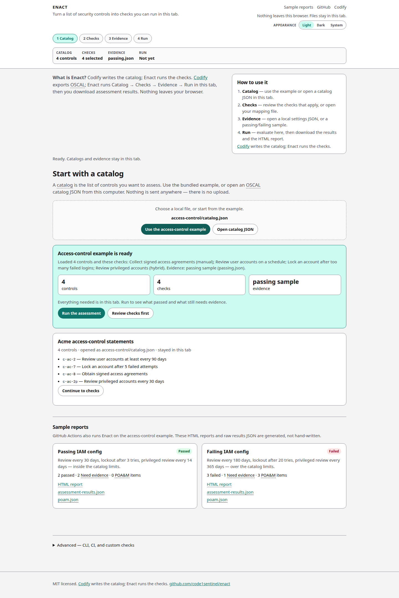

# Quick start

Use the bundled access-control example. You do not need your own files.

1. Open [https://code1sentinel.github.io/enact/](https://code1sentinel.github.io/enact/).
2. On **Catalog**, click **Use the access-control example**.
3. Read the summary card, then click **Run the assessment**.

That is enough to see Passed and Need evidence rows, then download results.

## What the example loads

The example fills the later steps for you:

- An OSCAL catalog of four access-control statements
- Four matching checks (two automated, one manual, one hybrid)
- The passing sample evidence (`passing.json`)

The card lists how many controls and checks are in the tab, which sample evidence was loaded, and one primary action: **Run the assessment**. You can review [checks](checks.md) or [evidence](evidence.md) first if you want.

## After you run

On the passing sample you should see:

| Status | Count | Meaning |
| --- | --- | --- |
| Passed | 2 | Account review and login lockout meet the catalog limits. |
| Failed | 0 | Nothing to fix. |
| Need evidence | 2 | Signed access agreements (manual) and privileged-account review (hybrid sign-off). |
| Draft | 0 | No unreviewed stubs in this example. |

Downloads stay disabled until a run exists. Then you can take `assessment-results.json`, `poam.json`, and the HTML report. See [Run and results](run-and-results.md) and [Outputs](outputs.md).

To try the other sample, go to **Evidence**, click **Use failing sample**, and run again. The failing sample is over the catalog limits and opens POA&M items for the automated failures.
