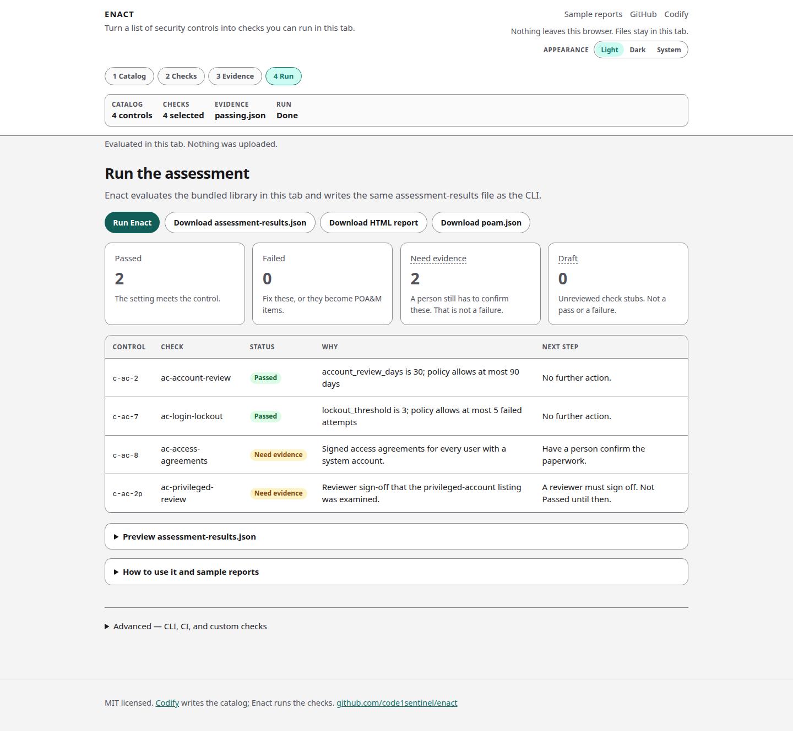
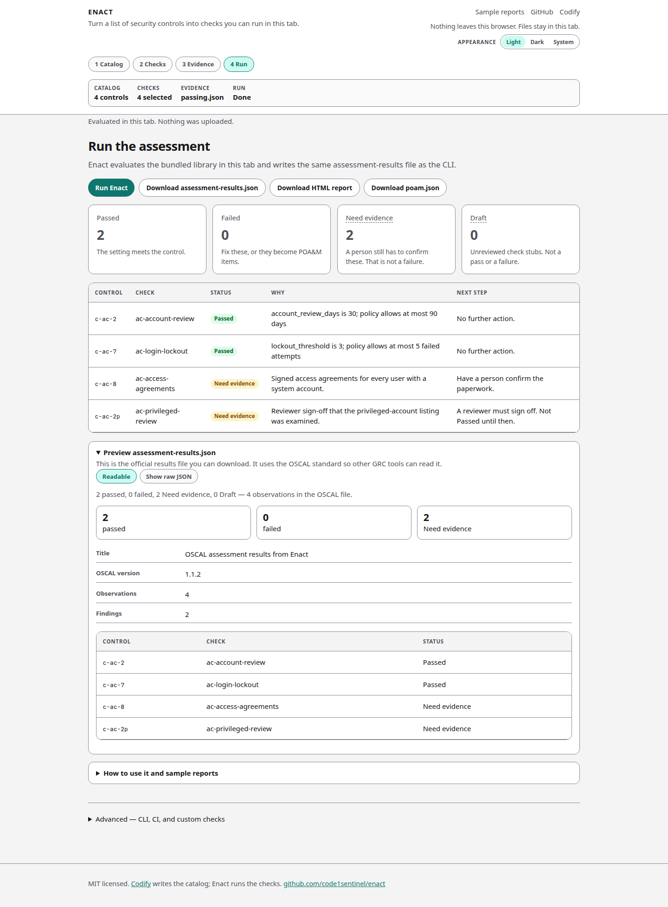

# Run and results

Enact evaluates the bundled library in the tab and writes the same assessment-results file as the CLI.

## How to run

1. Load a [catalog](catalog.md), [checks](checks.md), and [evidence](evidence.md) — or use the access-control example.
2. Open **Run**.
3. Click **Run Enact** (the summary card’s **Run the assessment** does the same thing).

Status text will say the evaluation happened in this tab and nothing was uploaded.

Download buttons stay disabled until a run exists:

- Download `assessment-results.json`
- Download HTML report
- Download `poam.json`

## Statuses

| Label | Meaning | Typical next step |
| --- | --- | --- |
| **Passed** | The setting meets the control. | No further action. |
| **Failed** | The setting is over the limit (or the run hit an error). | Fix the setting, or add a POA&M item. |
| **Need evidence** | A person still has to confirm this. Not a failure. | Manual: confirm the paperwork. Hybrid: sign off. |
| **Draft** | An unreviewed check stub. Not a pass or a failure. | Review the stub in the CLI before trusting it. |

On the passing example you should see **2 Passed**, **0 Failed**, **2 Need evidence**, **0 Draft**.

The results table has **Why** (what the check found) and **Next step** (what to do). Those are different sentences.

## Hybrid sign-off

Privileged-account review (`c-ac-2p`, check `ac-privileged-review`) is **hybrid**.

Even when `privileged_review_days` is within the limit (14 days vs a 30-day policy on the passing sample), the row stays **Need evidence**. The automated half only checks the cadence. A reviewer must still sign off that they looked at the privileged-account listing. It is not Passed until then.

Signed access agreements (`c-ac-8`) are **manual**. Enact never fails that row on its own. Someone confirms the paperwork exists.

## Results preview

Open **Preview assessment-results.json** for a readable summary of the official file: counts, title, OSCAL version, observation and finding counts, and one row per check.

**Show raw JSON** is the document you download. Other GRC tools read it because it is NIST OSCAL 1.1.2. See [Outputs](outputs.md).
